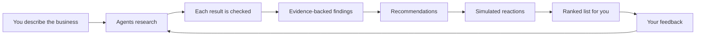

# Business Intelligence Factory

The Business Intelligence Factory (BIF) researches a business for you. You describe the business
and its problems. A team of AI agents then studies the market, the competitors and your own
company, checks every result against stored evidence, and turns what holds up into ranked
recommendations. You stay in charge: you review what the agents produce, and your reactions make
the next round of work better.

BIF runs on your own computer. It uses AI coding assistants you already have (Claude Code, Codex
and OpenCode) as its agents. An *agent* here is one of these assistants given a single, narrow job,
such as "find this competitor's prices" or "check this finding".

## What it produces

- **Findings.** Single facts about the market, a competitor or your company, each tied to its
  evidence: a screenshot, a saved web page, a document or a file you uploaded.
- **Competitor profiles.** Who you compete with, how they position themselves, and how their key
  journeys work (sign-up, pricing, checkout and so on).
- **Ranked journeys.** For each kind of journey, such as signing up, a ranking of how well each
  company handles it, yours included. BIF calls these journeys *flows*.
- **Personas.** Evidence-based profiles of your customer segments, and of the people inside and
  around the company whose approval a change needs.
- **Recommendations.** What to do, each citing the findings behind it, scored and put in priority
  order. Simulated reactions from the personas sit next to each one.

## From question to recommendations



1. **Interview.** You chat with an interviewer agent about the business: what it sells, who its
   customers are, what is going well and what is not. You can upload spreadsheets, PDFs or decks.
2. **Research.** BIF works in stages: the market, then competitors, then deep dives into each
   competitor and your own company, then the people involved. In each stage a planning agent splits
   the work into small tasks and other agents carry them out. Agents can browse the web, walk
   through sign-up and checkout pages, and take screenshots as they go.
3. **Checking.** Every task's result goes to a separate reviewer agent, which scores it and lists
   problems. The first agent fixes them or explains why not, up to a set number of rounds. Only
   results that pass are used later.
4. **Recommendations.** An agent links the problems you described to what research found, and
   writes recommendations that cite their findings.
5. **Reactions.** Simulated customers and stakeholders read each recommendation and say how they
   would react.
6. **Ranking.** Recommendations are put in priority order using weights you can change.
7. **Your review.** You rate, correct, include or exclude anything. Some research can repeat on a
   schedule, and BIF shows what changed since last time.

## The main parts

**The business tree.** A *workspace* is one business or one part of it, such as a division,
product line, region or team. Workspaces form a tree. BIF can suggest the parts of your business
for you to accept or reject. Each part can use what its own tree knows, never another company's
data. A parent part sees patterns that repeat across its children.

**Research and review.** Every piece of work is a *task* with a brief. A *reviewer*, a separate
agent that did not do the work, checks it. A task that passes is *verified*. One that runs out of
rounds is *unverified* and clearly marked. When a task cannot pass, BIF may ask you up to three
multiple-choice questions and then try again with your answers.

**Evidence.** Every finding must point to stored evidence, and quotes are checked against the
stored text. Facts are kept over time: a later run confirms a fact, replaces it with a newer
version ("price rose from $10 to $12") or retracts it. Nothing is deleted, so you can see a fact's
history.

**Personas and the persona panel.** A *persona* is a simulated member of an audience, built from
evidence. In the *persona panel*, each persona reads each recommendation on its own, without
seeing the others, and the reactions are shown side by side. The panel is a way to find objections
and things to check with real people. It is not a survey, it produces no numbers about real
customers, and by default it does not change priority.

**Stakeholders.** A *stakeholder* persona stands for someone whose approval or data a change
depends on: leaders, the board, investors, partner teams, or leaders at a competitor. Before BIF
shows what its research found about your own stakeholders, it asks you a few fixed questions about
each, so your answers are your own. You can record when someone leaves, moves or is promoted.

**The review council.** For the most important kinds of work you can ask for a *council*: several
reviewers, each on its own AI model and each looking for one kind of problem, such as weak
evidence or faulty reasoning. Their verdicts are combined by fixed rules, not by another AI. It
costs more, so it is off until you choose where to use it.

**Learning from feedback.** Your ratings and corrections are all recorded. When the same problem
keeps coming back, BIF proposes a rule for the agents' instructions. Once a week a review of the
week (the *retro*) proposes further changes, including changes to personas that you keep
disagreeing with. Nothing changes until you accept it. BIF can also have a different model re-check
past reviews, and run two versions of a task side by side to compare them.

**A picture of you.** BIF keeps a short description of what you care about, learned from your
actions. You decide every line of it, and it only reaches the agents that plan and present work,
never the ones that check it.

## Where you work in the app

| Page | What you do there |
|---|---|
| Business map | see the parts of the business and accept or reject suggested parts |
| Interview | describe the business and upload files |
| Research | start research, follow tasks and see what changed since the last run |
| Findings & Evidence | read findings with their evidence; choose which ones recommendations may use |
| Competitors, Flows | compare competitors and the rankings of their journeys |
| Audience & Personas, Stakeholders | read the personas; answer the stakeholder questions |
| Strategy | read recommendations, their priority and the simulated reactions; change the weights |
| Review queue, Decision log | rate what the agents produced; see every decision and your feedback |
| Lessons, You | accept or reject what BIF proposes to learn |
| Usage & prompts, Metrics | see cost, quality trends and the instructions each agent ran with |
| Schedule, Knowledge, Audits & experiments | repeat research on a schedule; search everything BIF knows; re-check reviews and compare versions |

A "Waiting on you" banner appears when an agent needs an approval, a login or an answer.

## Words used in this README

| Word | Meaning |
|---|---|
| Agent | an AI assistant given one narrow job |
| Workspace | one business, or one part of it |
| Task | one piece of research work with a brief |
| Finding | one fact, tied to stored evidence |
| Verified | a result that passed review |
| Persona | a simulated person, built from evidence |
| Flow | a journey such as signing up or checking out |
| Retro | the weekly review in which BIF proposes improvements |

## What stays private

- Everything is stored on your computer. The server only accepts connections from the same
  computer, and has no login, so other programs on the computer can reach it.
- The agents send what they work on to the AI provider behind each assistant, as any use of those
  assistants does. Scanned documents and images are read by an AI model too, unless you switch that
  off.
- Agents browse with a separate research browser profile, never your everyday one. Payments, demo
  requests and contacting real people need your approval. Purchases are never made.
- Agents see your uploaded files only as a name, type and size until they open one, and every
  opening is logged. Research about your own stakeholders is told never to put anything from your
  uploads or the interview into a web search.
- The data export for training leaves out anything that came from your uploads or from the inside
  view of your stakeholders, unless you ask for it.

## Getting started

You need Node.js 25 or later and at least one of the AI assistants installed and signed in.

```sh
npm install
cp bif.config.example.json bif.config.json
npm run build:web
npm start
```

Then open http://127.0.0.1:4317 in your browser. Sign in to each assistant you enable (`claude`,
`codex`, `opencode`) once in a terminal before starting. The settings file controls which
assistants and models are used; the Settings page edits the same file.

There is also a packaged app for macOS and Windows that needs none of the commands above. It is in
beta. See [docs/beta-testers.md](docs/beta-testers.md).

## Where to read more

- [docs/README.md](docs/README.md): the index of the technical documentation.
- [docs/architecture.md](docs/architecture.md): how the parts fit together, with diagrams.
- [docs/setup.md](docs/setup.md): installation, the research browser and running the server.
- [docs/configuration.md](docs/configuration.md): every setting and its default.
- [docs/desktop-app.md](docs/desktop-app.md): the packaged app for macOS and Windows.
- [docs/feedback-bundle.md](docs/feedback-bundle.md): the feedback file a tester can send.
- [docs/known-limitations.md](docs/known-limitations.md): what does not work yet.

Created in [T3 Code](https://t3.codes).
