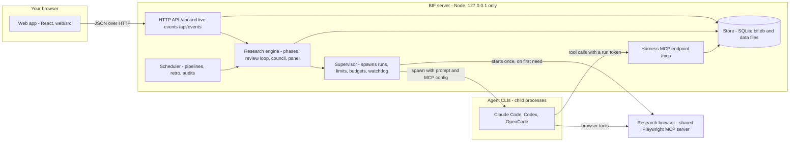
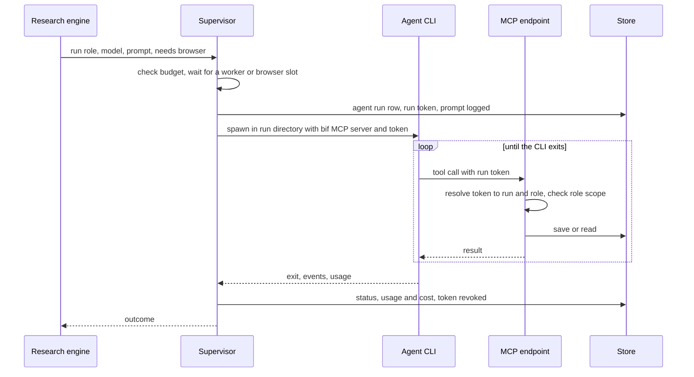

# Architecture

BIF is one local Node process with a SQLite database, a React web app, and agent CLIs that it starts
as child processes. The agents call back into the same process through an MCP endpoint, which is the
only way they can save anything.

Main design spec:
[superpowers/specs/2026-11-12-business-intelligence-factory-design.md](superpowers/specs/2026-11-12-business-intelligence-factory-design.md).

## System overview

| Part | Code | What it does |
|---|---|---|
| Web app | `web/src/` (`views/`, `logic/`) | React pages per workspace: Business map, Interview, Audience & Personas, Stakeholders, Research, Findings & Evidence, Competitors, Flows, Strategy, Review queue, Decision log, Schedule, Usage & prompts, Knowledge, Lessons, Audits & experiments, Metrics, You; plus the workspace list and Settings. Built to `web/dist` |
| Server entry | `src/api/main.ts` | loads config, opens the store, builds the harness and the app, listens on 127.0.0.1, resumes interrupted work, starts the scheduler, the escalation service and the extraction and OCR queues |
| HTTP API | `src/api/routes.ts` and `src/api/*Routes.ts` | Hono routes under `/api`; host, origin and content-type checks; serves `web/dist` at `/` and artifacts |
| Live events | `src/api/sse.ts`, `src/core/events.ts` | an in-process event bus, streamed to the web app as server-sent events |
| Harness MCP endpoint | `src/api/mcp.ts`, `src/core/harness/tools/` | a stateless MCP server per request, bound to the run its token names; lists and dispatches only the tools of that run's role |
| Supervisor | `src/core/harness/supervisor.ts`, `adapters/` | starts each agent run as a CLI process in its own run directory; enforces limits, budgets, the idle watchdog and rate-limit back-off; records events, usage and the prompt |
| Research engine | `src/core/research/`, `src/core/council/`, `src/core/market/`, `src/core/flows/`, `src/core/stakeholders/` | phases, tasks, the review loop and the runner phases |
| Store | `src/core/store/`, `src/core/evidence/`, `src/core/knowledge/` | SQLite schema and repos, content-addressed files, text extraction |
| Scheduler | `src/core/scheduler/` | cron jobs: scheduled pipelines, the weekly retro, audit schedules |
| Research browser | `src/core/harness/browser.ts` | the shared browser MCP server (see [setup.md](setup.md#research-browser-profile)) |

## How an agent run works

- **Roles.** `orchestrator`, `worker`, `reviewer`, `interviewer`, `persona`, `synthesizer`,
  `escalation`, `retro`. Each role sees only its own tools. For example a reviewer has
  `log_decision`, `submit_review`, `read_artifact`, `expand` and `read_flow_catalog`; a persona has
  `log_decision`, `submit_persona_feedback`, `submit_flow_verdicts` and `submit_stakeholder_read`. The
  full table is `ROLE_TOOLS` in `src/core/harness/tools/registry.ts`.
- **Tokens.** Each run gets a token. The MCP endpoint answers at `/mcp/:token` and at `/mcp` with a
  bearer token. Unknown, revoked or finished-run tokens get HTTP 401. How each CLI receives its token
  is in [setup.md](setup.md#agent-cli-isolation).
- **Concurrency.** Runs of the roles worker, reviewer, persona and synthesizer count against
  `limits.maxParallelWorkers`. Browser-using runs also take a slot of `limits.maxBrowserRuns`.
- **Failures.** A run with no output for `limits.idleTimeoutMs` is killed. A rate-limited run is
  retried with back-off (base 30 seconds, at most 15 minutes, at most 6 attempts), holding its slot.
- **Offline runs.** Some runs must not reach the web (own-stakeholder reads, combine and learning
  runs for internal personas, the user persona's learning run). The adapter denies the CLI's web and
  shell tools; a CLI that cannot enforce that (Codex) fails the run before it starts.
- **Blocking tools.** `request_approval` keeps the MCP request open until you answer in the web app.

## From question to recommendations

1. **Interview.** You chat with the interviewer agent. It fills the profile and records symptoms.
2. **Pipeline.** You start a pipeline (or a schedule does). Each phase is one research run. See
   [research-pipeline.md](research-pipeline.md#phases) for the phase diagram.
3. **Tasks.** In an orchestrator phase the orchestrator proposes tasks; each task runs through the
   [review loop](research-pipeline.md#review-loop), or a [council](council.md) for the stages you
   name.
4. **Evidence.** Workers save artifacts and findings into the [knowledge store](knowledge-store.md).
   Only verified (or included) findings feed synthesis.
5. **Synthesis.** Symptom hypotheses and recommendations, each citing its findings.
6. **Reactions.** The [persona panel](persona-panel.md) and [stakeholder reads](stakeholders.md#reads)
   add simulated reactions. Flow ranking runs before synthesis (see [flows.md](flows.md)).
7. **Scoring.** Priority is recomputed from the criteria weights.
8. **Feedback.** You rate, include, exclude and correct. That feeds [learning](learning.md).

## Start-up and restart

On start the server:

1. loads and validates the configuration, and prints warnings (browser setup, offline providers,
   unavailable council members and panel seats);
2. opens the store, runs migrations and idempotent knowledge backfills;
3. listens on 127.0.0.1;
4. resumes interrupted work: interrupted agent runs are marked failed, their tasks requeued (round
   kept), tasks waiting for you stay waiting, and running pipelines continue; experiments left running
   are marked interrupted;
5. starts the scheduler (missed runs execute once), the extraction queue and the OCR queue.

On shutdown it stops the scheduler, closes connections, stops the shared browser server and closes
the store. Running CLI process groups are left to the resume step of the next start.
