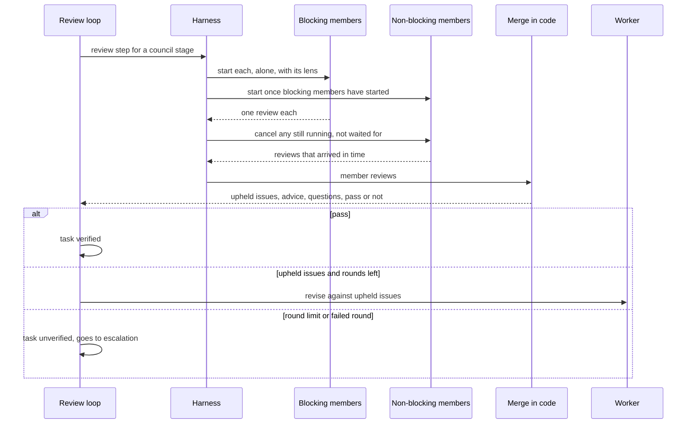

# Review council

A task type can be reviewed by a council instead of one reviewer: several reviewer runs started in
parallel, each alone, each through one lens, on the CLIs and models you name. Their reviews are
merged into one review per round by fixed rules in code; no model merges, ranks or rules.

It is opt-in per task type. With no `council` block, and for every task type you do not name under
`council.stages`, the [review loop](research-pipeline.md#review-loop) is exactly what it was.

Code: `src/core/council/` (`settings.ts`, `round.ts`, `merge.ts`, `lenses.ts`, `store.ts`), member
rules in `src/core/prompts/council_member.md`. Design:
[superpowers/specs/2026-11-16-review-council-design.md](superpowers/specs/2026-11-16-review-council-design.md).

## Where it is worth its cost

A council of N members costs N reviewer runs per round, each with its own tokens, logs and budget
use. So seat one where a wrong pass is expensive and the tasks are few:

- `synthesize_recommendations`: few tasks; its recommendations and their scores are what you act on;
- `symptom_hypotheses`: causal claims that steer later research.

One reviewer is enough for bulk evidence gathering, which has many tasks per run and is sampled by
the reviewer audit. The persona panel, stakeholder reads, learning runs, the combine run and
escalation are not review steps and never get a council.

## Configuration

The council reviews nothing until you name a stage. The example file defines four members and seats
them in no stage.

```jsonc
"council": {
  "rounds": 3,              // most review rounds of a council stage (default 3)
  "passScore": 9,           // every blocking member must score this or more (default 9)
  "blockOn": "any",         // any | majority | all: blocking members needed to uphold an issue (default any)
  "onUnavailable": "fail",  // fail | report: what a missing blocking member does (default fail)
  "members": [
    { "name": "evidence",  "provider": "claude", "model": "opus",        "lens": "evidence" },
    { "name": "second",    "provider": "codex",  "model": "gpt-6.1-sol", "lens": "evidence", "effort": "high" },
    { "name": "reasoning", "provider": "claude", "model": "sonnet",      "lens": "reasoning" },
    { "name": "redo",      "provider": "claude", "model": "opus",        "lens": "rewrite", "blocking": false }
  ],
  "stages": {
    "synthesize_recommendations": { "members": ["evidence", "second", "reasoning"], "rounds": 4 },
    "symptom_hypotheses": {}
  }
}
```

| Key | Meaning |
|---|---|
| `members[].name` | unique; stages seat members by it and the council table shows it |
| `members[].provider` | `claude`, `codex` or `opencode` (`cli` is accepted as another spelling; give one of the two). Any other name is a configuration error that lists these three |
| `members[].model` | a model of that provider |
| `members[].lens` | exactly one lens (see below) |
| `members[].effort` | optional: the reasoning effort in the CLI's own words (e.g. `high`), passed as Claude Code `--effort`, Codex `-c model_reasoning_effort=` or OpenCode `--variant` |
| `members[].blocking` | default `true`. A non-blocking member's score is never counted, its issues alone uphold nothing, and a round does not wait for it: it is started after the blocking members, and one still running (or not started yet) when they have ended is cancelled and shown as "not waited for" |
| `rounds`, `passScore` | for a council stage they replace `loop.maxRounds` and `loop.passThreshold` (and their per-task-type overrides). Defaults 3 and 9 |
| `blockOn` | an issue is upheld when one blocking member raised it (`any`, the default), more than half of the blocking members with a score (`majority`), or all of them (`all`). Other issues are shown to the worker as advice |
| `onUnavailable` | `fail` (default) or `report`; see [When a member is unavailable](#when-a-member-is-unavailable) |
| `stages` | the task types a council reviews. `stages.<type>.members` seats some members by name (omitted: the whole council); `stages.<type>.rounds` and `.passScore` override the council's. A stage must seat at least one blocking member |

Lenses:

| Lens | What the member looks for |
|---|---|
| `evidence` | each claim against the copy it cites |
| `brief` | each acceptance criterion and each thing the brief asks |
| `reasoning` | the step from evidence to conclusion |
| `privacy` | upload-derived or interview text where it must not be, data of another business tree, stored secrets |
| `value` | useless findings: ones whose removal would change no recommendation, hypothesis or answer |
| `rewrite` | a better way to do the same task |

Every member also reports a useless finding or a rewrite when it sees one.

## A round



Each member is started with what the single reviewer is started with (same tools, same review slice)
plus the council rules and its lens, and never sees another member's review. Its model is its own:
the reviewer-swap rule of the single reviewer does not apply, and no other model ever takes a
member's place.

The rules every member is told:

- nothing under review is precious: it may propose discarding the deliverable and redoing it another
  way, within the same task;
- no nits: style and preference never block and never lower a score;
- no scope creep: a real problem outside the brief is a follow-up;
- evidence or nothing: an issue that names neither an output nor an evidence copy is a question;
- a score below the pass score needs a blocking or substantive issue.

Blocking members are started first, so a non-blocking member never holds a worker slot one of them
waits for. Only blocking members decide. What a non-blocking member raises is attached to the issue
blocking members raised about the same thing (its name, its evidence, its words) or shown as advice,
and never changes whether an issue is upheld or whether the round passes.

The merge then, in order:

1. turns each member's issue that names neither an output nor evidence into that member's question,
   before anything is joined (such an issue is no vote for what another member showed);
2. joins issues of different members about the same thing, keeping every member's name and wording.
   The text the worker reads is the first wording, then `Also raised by <name>: ...` for each other
   one that is not a near-repeat. Two issues are about the same thing when both reuse the id of an
   earlier issue they were shown, or they name a common output in loosely similar words, or their
   words alone are close;
3. drops nits and scope issues (scope issues are kept as follow-ups);
4. takes off each issue the ids that are not outputs of the task or not in its review slice (an issue
   left with neither is a question too);
5. lets an issue the worker pushed back on block again only when a blocking member that raises it
   again says something new (the earlier words repeated do not block);
6. from the second review of a deliverable, treats a substantive issue no member raised before as
   advice, so the task does not grow with every round. A new blocking issue still blocks. The first
   review of work that was done again after an escalation is a first review, whatever its round
   number;
7. applies `blockOn`;
8. lets an upheld rewrite replace every other issue about the outputs it discards.

A score below the pass score stands only when its member raised an upheld issue. The round passes
when every counted score is at or above the pass score and no upheld issue stands. Otherwise the
worker answers the upheld issues and is shown the advice and the questions. At the round limit the
task ends *unverified* and goes to you through the escalation, like any other.

## When a member is unavailable

A member is unavailable when its provider is disabled, its model is not in that provider's `models`,
its CLI cannot be started, or its run ends without a valid review. This is never a configuration
error, so one configuration works on machines with different CLIs: the server prints a warning at
start-up naming the member, and the council table shows it. No other model ever takes a member's
place.

- With `onUnavailable: "fail"`, a missing blocking member ends the task *unverified*, with the member,
  provider, model and cause as the reason, and no revision is made on a partial council. This happens
  before any member runs when the configuration cannot start it, and once the round's blocking
  members have ended when its run fails or gives no review (the other members' reviews are kept on
  the round's record).
- With `"report"` the round goes on without it. With no blocking member left it fails all the same.
- A non-blocking member never ends a task: it is shown as unavailable and the round runs with the
  others, under both settings.

A round that failed because a member was unavailable is treated as "no review took place": its score
is 0, nothing is put to the worker, and the last review shown on the task's results says that the
round did not count. Known limit: when you then re-run the task from the escalation, the work is
redone, not only reviewed again.

## What you see

Where a result shows its last review (Findings & Evidence, Strategy, Audience & Personas,
Competitors), a council review says so and "Show the council" opens the table: members down, rounds
across, each cell `7/10`, "no score", "unavailable" or "not waited for". Below it are the open issues
with who raised each, the advice, the questions and the follow-ups.

On the Research page every task a council reviewed has "Show the council" in its row, also a task
that passed. In the list of review rounds a member's own review is labelled `council member: <name> (<lens>)`.

| Route | Serves |
|---|---|
| `GET /api/workspaces/:id/tasks/:taskId/council` | the council table of a task. A task of another business tree answers like an unknown one; private own-stakeholder research is withheld there as everywhere |
| `GET /api/council` | the configured council for Settings, each member available or not and why; the configuration only, nothing of any task |

Everything else reads a council round as one review: the issue history, outcomes, the review queue
("Council review score"; a member's own review stays ratable, marked with its name), experiments and
the export. The reviewer audit skips tasks whose final review was a council. Runs, usage and cost
stay per member run.

## The development skill and credit

For BIF's own development the same idea is a skill, `.claude/skills/council/SKILL.md`: members review
a feature branch against its plan and spec. Both are adapted from the council skill of tstack
(https://github.com/t3dotgg/tstack/blob/main/skills/council/SKILL.md).
