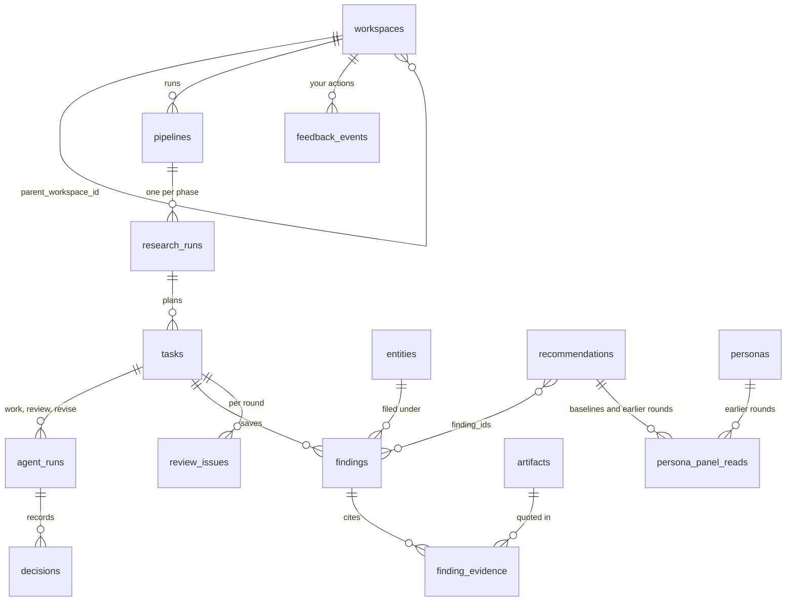

# Data storage

Where BIF keeps its data on disk, and the main records in the database.

Code: `src/core/store/` (`db.ts`, `migrations.ts`, the repos), `src/core/evidence/artifacts.ts`,
`src/core/harness/paths.ts`.

## Where data lives

Under `dataDir` (default `./data`, gitignored):

| Path | Contents |
|---|---|
| `data/bif.db` | SQLite, one database for every business: workspaces, interview, runs, decisions, outputs, the learning-loop tables and the knowledge store (tables by area: design spec §5.1) |
| `data/<workspaceId>/artifacts/` | screenshots, page snapshots, documents and uploads (content-addressed by sha256) |
| `data/<workspaceId>/personas/<persona>.md` | compiled persona prompt (latest version; `<persona>.v<N>.md` keeps each version) |
| `data/<workspaceId>/runs/<agentRunId>/` | per-run working directory (`cwd/`), event log (`events.jsonl`) and the full prompt (`prompt.md`; `prompt.attemptN.md` per rate-limit retry) |
| `data/<rootWorkspaceId>/calibration/<role>.md` | current approved prompt calibration of one business tree (every earlier version is kept in the database, `calibration_versions`) |
| `data/browser-profile/` | the research browser profile (`browser.profileDir`) |
| `data/browser/shared-server.log` | log of the shared browser server |
| `data/cli-state/` | isolated CLI state for Codex and OpenCode (see [setup.md](setup.md#agent-cli-isolation)) |

### What the agent CLIs keep outside the data folder

Found by probes on macOS on 2026-11-16 (Claude Code 2.1.325, Codex 0.169.0): runs that wrote and edited a
file, ran shell commands and got a shell result too large to return inline. One run of each CLI ended by
itself; one Claude run was killed with SIGKILL while a shell command ran, and one was ended by BIF's idle
timeout (a polite stop, then SIGKILL after the grace). Linux and Windows were not probed.

**Claude Code** (`--no-session-persistence`, and `--session-id` with an id BIF derives from the run and the
attempt). `<run folder>` is the run's working directory with every character other than a letter or digit
replaced by `-`; `~/.claude` is `CLAUDE_CONFIG_DIR` when set; `/tmp` is `CLAUDE_CODE_TMPDIR` when set.

| What | Where | When it is there | What BIF does |
|---|---|---|---|
| the transcript | – | never written | prevented (`--no-session-persistence`) |
| results too large to return inline (page snapshots, long shell output) | `~/.claude/projects/<run folder>/<id>/tool-results/` | while the run lasts; after a forced kill | removed with the run's project folder |
| an empty `memory/` folder | `~/.claude/projects/<run folder>/` | after every run | removed |
| an empty folder | `~/.claude/session-env/<session id>/` | after every run | removed |
| the output of a shell command | `/tmp/claude-<uid>/<run folder>/<session id>/tasks/` | while the command runs; after a forced kill | removed |
| file history (edit backups), todo lists, prompt history (`history.jsonl`), debug logs, an entry in `~/.claude.json` | – | not written by these runs | – |
| the live-session entry: session id, working directory and process id (no prompt, no result) | `~/.claude/sessions/<pid>.json` and a `.key` file beside it | while the run lasts; after a forced kill | not removed by BIF (the key file's name is not derived from the run); Claude Code removed the stale entry at its next start |
| a snapshot of your shell's functions, aliases and `PATH` (nothing of the run) | `~/.claude/shell-snapshots/snapshot-<shell>-<time>-<random>.sh` | while the run lasts; after a forced kill | not removed: its name is not derived from the run |
| an empty socket file | `/tmp/cc-socks/<pid>.sock` | after a forced kill | not removed |

BIF removes the run's leftovers when each attempt ends, whatever ended it: a normal end, a failure, the idle
timeout or a stop (once the CLI's processes are gone), a shutdown (`stopRuns`, and the forced stop when a
shutdown runs out of time) and, for runs a crash left `running`, the recovery of the next start
(`resumeInterrupted`). After a crash they stay until BIF starts again. Only paths named after the run's
working directory and session ids are removed, each checked to lie directly inside its folder; nothing is
removed by pattern. If `<run folder>` is longer than 200 characters, Claude Code shortens it and adds a hash
that BIF does not reproduce, so that folder is left (a data folder path of about 130 characters or more), and the server log says so.
Code: `src/core/harness/cliLeftovers.ts`. The real kill probe through BIF (the idle timeout) left nothing of the
run, not even the shell snapshot or the session entry: the CLI removes those itself on the polite stop.

**Codex** keeps everything in its private home, `data/cli-state/codex-home`, inside the data folder.
`--ephemeral` (help: "Run without persisting session files to disk") keeps the session transcript and the
thread records from being written. After a run, the home held no `sessions/` folder and no `history.jsonl`;
its databases (`state_5`, `logs_2`, `memories_1`, `goals_1`, `queue_1`) held no row of the run (threads 0,
logs 0); `shell_snapshots/` was empty. What it keeps is the CLI's own: `installation_id`, `models_cache.json`,
the list of the apps of your ChatGPT account (`cache/codex_apps_tools/`), OpenAI's curated plugins
(`plugins/cache/`, about 34 MB) and empty folders. None of it holds a run's prompts or results. It is kept
until you delete `data/cli-state/` (BIF re-creates what it needs); BIF's retention does not touch it. A Codex
run killed in the middle of a command was not probed.

**OpenCode** stores sessions (`opencode.db`), oversized tool output (`tool-output/`), logs and snapshots in
its own data folder (`~/.local/share/opencode`), which also holds its login. It has no option to keep a run
from being stored, and moving its data folder would move its login; see
[known-limitations.md](known-limitations.md). Not probed (OpenCode has not been run end to end).

Approved prompt patches are per business: they are merged (appended, deduplicated) into
`data/<rootWorkspaceId>/calibration/<role>.md` of the workspace's tree root and only reach prompts of
that business tree. Nothing is written under `src/`.

The design spec is
[superpowers/specs/2026-11-12-business-intelligence-factory-design.md](superpowers/specs/2026-11-12-business-intelligence-factory-design.md).

## Main records

The schema is built by numbered migrations in `src/core/store/migrations.ts`; there are about sixty
tables. The diagram shows only the central ones. Most links are plain id columns, not foreign-key
constraints, and some are JSON lists (a recommendation's `finding_ids`, a finding's `evidence`).
Most tables carry a `workspace_id`; some knowledge-store tables also key on the business tree root.

| Table | What a row is |
|---|---|
| `workspaces` | a business or a part of it; `parent_workspace_id` makes the tree; `scope` and `audiences` |
| `pipelines` | a requested run of several phases, with `next_index` so a restart can continue |
| `research_runs` | one phase run (`phase`, `status`, optional `schedule_id` and `pipeline_id`) |
| `tasks` | one unit of research work (`type`, `brief`, `model`, `status`, `round`, `step`) |
| `agent_runs` | one CLI run (`role`, `model`, run `token`, `status`, prompt version, experiment, audit and council tags) |
| `decisions` | what an agent or the harness decided (`kind`, `payload`, `refs`, prompt version) |
| `findings` | one version of a fact (`lineage_id`, `version`, `lifecycle`, `entity_id`, status) |
| `finding_evidence` | one cited artifact or quote of a finding |
| `artifacts` | a stored file (`sha256`, `kind`, `source_url`, description, upload flags) |
| `entities` | a named thing in one business tree, with aliases |
| `review_issues` | one issue of one review round, with its fate |
| `recommendations` | a recommendation with criteria, `finding_ids`, priority, and the current persona reactions (`persona_feedback`, JSON) |
| `personas` | a segment or stakeholder persona (`kind`, `slug`, `version`, profile, agent.md path) |
| `persona_panel_reads` | a baseline read (`kind` `baseline`) or an earlier persona round kept when a later round replaced it (`kind` `persona`) |
| `feedback_events` | one human action, with before, after, reason and actor |
