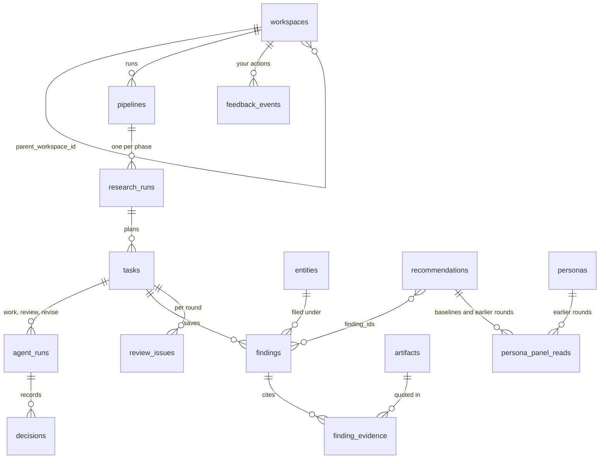

# Data storage

Where BIF keeps its data on disk, and the main records in the database.

Code: `src/core/store/` (`db.ts`, `migrations.ts`, the repos), `src/core/evidence/artifacts.ts`,
`src/core/harness/paths.ts`.

## Where data lives

Under `dataDir` (default `./data`, gitignored):

| Path | Contents |
|---|---|
| `data/bif.db` | SQLite, one database for every business: workspaces, interview, runs, decisions, outputs, the learning-loop tables and the knowledge store (tables by area: design spec §5.1) |
| `data/<workspaceId>/artifacts/` | screenshots, page snapshots, documents and uploads (content-addressed by sha256) |
| `data/<workspaceId>/personas/<persona>.md` | compiled persona prompt (latest version; `<persona>.v<N>.md` keeps each version) |
| `data/<workspaceId>/runs/<agentRunId>/` | per-run working directory (`cwd/`), event log (`events.jsonl`) and the full prompt (`prompt.md`; `prompt.attemptN.md` per rate-limit retry) |
| `data/<rootWorkspaceId>/calibration/<role>.md` | current approved prompt calibration of one business tree (every earlier version is kept in the database, `calibration_versions`) |
| `data/browser-profile/` | the research browser profile (`browser.profileDir`) |
| `data/browser/shared-server.log` | log of the shared browser server |
| `data/cli-state/` | isolated CLI state for Codex and OpenCode (see [setup.md](setup.md#agent-cli-isolation)) |

Approved prompt patches are per business: they are merged (appended, deduplicated) into
`data/<rootWorkspaceId>/calibration/<role>.md` of the workspace's tree root and only reach prompts of
that business tree. Nothing is written under `src/`.

The design spec is
[superpowers/specs/2026-11-12-business-intelligence-factory-design.md](superpowers/specs/2026-11-12-business-intelligence-factory-design.md).

## Main records

The schema is built by numbered migrations in `src/core/store/migrations.ts`; there are about sixty
tables. The diagram shows only the central ones. Most links are plain id columns, not foreign-key
constraints, and some are JSON lists (a recommendation's `finding_ids`, a finding's `evidence`).
Most tables carry a `workspace_id`; some knowledge-store tables also key on the business tree root.

| Table | What a row is |
|---|---|
| `workspaces` | a business or a part of it; `parent_workspace_id` makes the tree; `scope` and `audiences` |
| `pipelines` | a requested run of several phases, with `next_index` so a restart can continue |
| `research_runs` | one phase run (`phase`, `status`, optional `schedule_id` and `pipeline_id`) |
| `tasks` | one unit of research work (`type`, `brief`, `model`, `status`, `round`, `step`) |
| `agent_runs` | one CLI run (`role`, `model`, run `token`, `status`, prompt version, experiment, audit and council tags) |
| `decisions` | what an agent or the harness decided (`kind`, `payload`, `refs`, prompt version) |
| `findings` | one version of a fact (`lineage_id`, `version`, `lifecycle`, `entity_id`, status) |
| `finding_evidence` | one cited artifact or quote of a finding |
| `artifacts` | a stored file (`sha256`, `kind`, `source_url`, description, upload flags) |
| `entities` | a named thing in one business tree, with aliases |
| `review_issues` | one issue of one review round, with its fate |
| `recommendations` | a recommendation with criteria, `finding_ids`, priority, and the current persona reactions (`persona_feedback`, JSON) |
| `personas` | a segment or stakeholder persona (`kind`, `slug`, `version`, profile, agent.md path) |
| `persona_panel_reads` | a baseline read (`kind` `baseline`) or an earlier persona round kept when a later round replaced it (`kind` `persona`) |
| `feedback_events` | one human action, with before, after, reason and actor |
