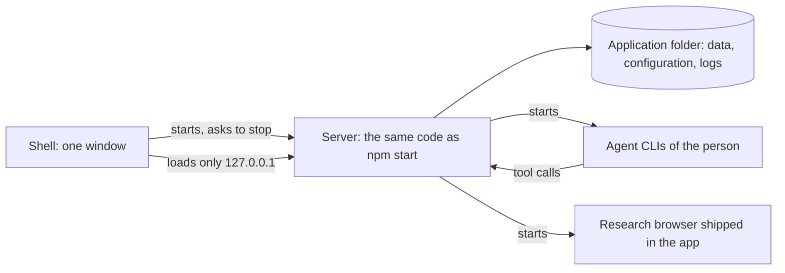

# The desktop app

BIF can be packaged as an application for macOS and Windows, so a person can use it without Node,
`npm` or a build step. The design and its "As built" notes are in
[the spec](superpowers/specs/2026-11-16-desktop-app-and-feedback-bundle-design.md). The guide for the
people who install it is [beta-testers.md](beta-testers.md).

## What it is

- The shell (`desktop/`) is an Electron program with one window. It starts the server as a child
  process, waits for the line that names its port, and opens the window on that address only. Web
  content has no access to Node or the file system; every request to another origin is refused, and
  links to other sites open in the system browser.
- The server is the compiled form of the same code a checkout runs (`npm run build:server`). It runs
  on the Node inside Electron (24.x). `npm run test:desktop-runtime` runs the whole test suite on
  that runtime.
- Quitting asks the server to stop on its standard input. The server stops every running agent and
  the research browser, then exits; after a time limit the shell stops what is left by process id.
  A second launch brings the first window forward.
- The agent CLIs are not shipped. The setup check (first on the Settings page, and `npm run doctor`
  in a checkout) says which are installed and signed in, without a model call, and writes a matching
  configuration with cost caps of 25 USD per pipeline and 100 USD per business.

## Where things live

| | macOS | Windows |
|---|---|---|
| Data, configuration, logs | `~/Library/Application Support/Business Intelligence Factory/` | `%APPDATA%\Business Intelligence Factory\` |

`BIF_APP_DIR` overrides the folder (used by the checks). A checkout started with `npm start` keeps
`./data` and `./bif.config.json`.

## Commands

| Command | What it does |
|---|---|
| `npm run doctor` | the setup check in a terminal |
| `npm run build:server` | the compiled server in `dist/server` |
| `npm run desktop:dev` | the shell from a checkout, with its files in `data/desktop-dev` |
| `npm run dist:mac` | the macOS `.dmg` files (Apple silicon and Intel) in `dist/installers`; add `-- --arm64` for one |
| `npm run dist:win` | the Windows installer in `dist/installers` (run on Windows) |
| `npm run test:desktop-runtime` | the test suite on the app's runtime |
| `npm run feedback:report -- <files or folders>` | a report from one or many feedback bundles |

The hosted workflow `.github/workflows/desktop.yml` runs the tests and builds both installers on a
version tag (`v*`) or when started by hand, and attaches them to a draft release.

## Signing

Builds are unsigned unless signing variables are present: `CSC_LINK` or `CSC_NAME` (macOS, with the
three `APPLE_*` variables for notarisation) and `WIN_CSC_LINK` (Windows). An unsigned macOS build
carries an ad-hoc signature and must be approved by hand the first time; an unsigned Windows build
shows an "unknown publisher" warning. [beta-testers.md](beta-testers.md) tells testers how to open
them.

## What was tried

- macOS (Apple silicon): built, launched from a Finder-like environment, a real interview turn on
  Claude, a feedback bundle made and read back, quit with and without a running agent.
- Windows 11 x64: the test suite, the installer built, installed and removed, a real interview turn
  on Claude, quit with a running agent, a feedback bundle.
- Not tried: a signed build on either platform, the Intel macOS build (built, not launched), Codex
  or OpenCode runs through the app, the hosted workflow.
