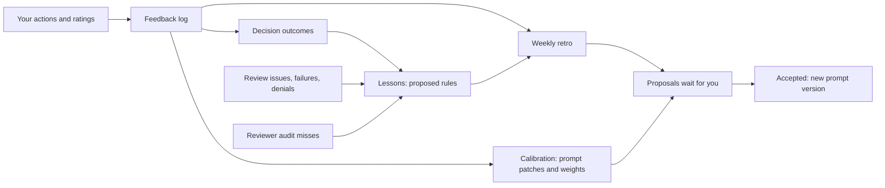

# Learning from feedback

How your ratings and actions are recorded, and how BIF turns them into better prompts: decision
outcomes, calibration, lessons and the weekly retro, reviewer audits and experiments. Persona
learning is in [personas.md](personas.md#persona-learning); the persona of you is in
[user-persona.md](user-persona.md).

Code: `src/core/feedback/`, `src/core/scoring/`, `src/core/learning/`. Spec:
[superpowers/specs/2026-11-13-learning-loop-parity.md](superpowers/specs/2026-11-13-learning-loop-parity.md).

## Ratings and calibration

Every criterion value on every item can be rated: agree, or disagree with your own value and reason
(inline or in the Review queue). Ratings are kept as history: changing a rating adds a new row and
the latest one is what the web app shows as your current rating (re-submitting an unchanged rating
sends nothing).

- **Priority** is a weighted combination of recommendation criteria. The Strategy page edits the
  weights and offers weights refit from your priority overrides (never auto-applied).
- **Pushbacks.** Worker pushbacks are ratable too (criterion `pushback`, 0–1: how justified it was).
- **Prompt patches.** The Decision log page proposes prompt patches per role from your
  disagreements; you edit and approve them before they are written. An approval keeps the role's
  calibration history (revertable on the Usage & prompts page) and is logged as a decision and a
  feedback event. Weight changes and reverts are logged the same way.

Approved prompt patches are per business: another company's prompts never see them. Where they are
stored and how they are merged: [data-storage.md](data-storage.md#where-data-lives).

The decision log plus ratings export as JSONL (see [privacy-and-export.md](privacy-and-export.md)).

## Feedback log

Every human action on agent output is also an append-only feedback event: who (`user.id`), when,
what changed (before → after), why, and the agent run and prompt version that produced the item.

Recorded actions:

- include overrides (findings, recommendations, personas, competitors, symptom hypotheses);
- profile edits;
- unit proposal accept / accept-with-edits / reject;
- symptom hypothesis corrections (Findings & Evidence page);
- request and escalation answers;
- weight changes, prompt patch approvals and calibration reverts;
- fact actions (scope change, retraction, accepting an unverified update).

Ratings store the agent run and prompt version they judged.

Feedback feeds calibration: excluding an output counts as a disagreement with it, including an
unverified one as an agreement, and unit proposal rejections / edits are scaled disagreements on the
proposing decision, so they rank among the prompt patch examples. When an agent revises an item after
you rated it, the item returns to the review queue. The Decision log page lists the feedback with
actor, time and reason.

The export adds answered requests, the interview transcript (each turn linked to its interviewer
run), feedback events and each output's final review status, under the upload rules.

## Decision outcomes

Agent decisions get labels after the fact (`decision_outcomes`):

| Outcome | When |
|---|---|
| `confirmed` | task verified; or you included an output the review did not verify |
| `over-scoped` / `missed-evidence` / `weak-review` | task unverified |
| `run-failed` | the run failed |
| `missed-evidence` | output superseded by a later round |
| `stale` | a scheduled re-run saved a new fact on the same subject with another claim, or a screenshot the finding cites changed, or the fact passed its TTL without a re-check |
| `user-rejected` | you excluded an output (finding, recommendation, persona, competitor or symptom hypothesis) or rejected a unit proposal. Excluding a verified output also marks the passing review `weak-review` |
| `reviewer-false-positive` | an issue dropped after a pushback |
| `worker-miss` | an upheld issue the worker then fixed |

For fact versions: `confirmed` (a verified confirmation), `changed` (replaced by a new version) and
`retracted` (by a run, or `user-rejected` when you retract it). The scheduler and the knowledge store
add more (see [research-pipeline.md](research-pipeline.md#scheduler-and-what-changed) and
[knowledge-store.md](knowledge-store.md#knowledge-tracking)).

Your actions reach outcomes from one place: the feedback event each action records. So each action
writes its outcome once, under your `user.id`. An outcome can also judge a non-decision subject (for
example a fact version), and each one is written once per subject, outcome and source event. The
Decision log shows the counts per role, task type and prompt version (this workspace or the whole
business tree); `GET /api/workspaces/:id/outcomes` serves them.

## Lessons and the weekly retro

Per role and per business, BIF watches recurring problems:

- review issue classes per task type;
- negative decision outcomes;
- run failures (not rate limits or other infrastructure);
- policy denials;
- your exclusions, corrections and rating disagreements on an agent's output;
- knowledge-store signals (zero-result searches, unused reads, duplicates, missing captions, rejected
  quotes);
- reviewer-audit misses (below);
- signals other features record (`recordLessonSignal`; a note is kept only when it names a task, run
  or item that is not upload-derived or exposed).

When one recurs in 3 tasks (`lessons.minTasks`), a rule is **proposed** on the **Lessons** page. You
accept or reject it (with an optional reason). Only an accepted rule is appended to that role's
prompt, tagged with a tracking marker (`[L-7F3A2C.v1]`), so the prompt version changes and every
run's stored prompt shows which rules it had.

The page shows each rule's effect: the category's rate before the rule and under its current
version, and per prompt version (with pass rate, rating agreement and cost). The engine then proposes
to strengthen a rule that keeps recurring, retire one after 10 clean tasks, or revert one whose rate
did not drop after 5 tasks; each is again yours to accept. At most 15 rules per role.

Rules are written from templates, never from stored text. Examples quote review issues only when they
are not upload-derived and not from an upload-exposed run or task (the export's rule); otherwise they
name the id.

**The retro.** Every Monday 06:00 (`lessons.retro.cron`) the scheduler runs a retro per business. The
`retro` agent reads a digest of the week: task results, costs, outcomes, review issues, failures,
denials, your feedback, knowledge signals, rules and pending proposals. The digest is fixed size,
redacted, fenced, and logged as a read before the run starts. The agent proposes prompt rules and
calibration notes citing digest ids, pending until you accept each one. The retro also runs persona
learning and user persona learning.

Accepts and rejects are feedback events (`lesson_accept` / `lesson_reject`) with your `user.id`;
accepts are also Decisions.

**Kill switch.** `lessons.enabled: false` means no proposals, no retro, and accepted rules leave every
prompt (the new prompt versions are recorded). Runs that must not see lessons (experiment arms,
reviewer audits) carry a stored lessons-off flag, so they keep it after a restart. They feed no
lessons either: their outcomes, ratings, feedback, failures and denials are not signals (reviewer
audit misses count once, as described below).

Settings: [configuration.md](configuration.md#lessons).

| Route (under `/api/workspaces/:id`) | Does |
|---|---|
| `GET …/lessons` | rules, proposals and effects |
| `POST …/lessons/evaluate` | runs the lessons engine now |
| `POST …/lessons/proposals/:pid/accept` and `…/reject` | `{reason?}` |
| `POST …/lessons/rules/:rid/propose-retire` | proposes retiring a rule |
| `POST …/lessons/retro` | runs a retro now |

## Reviewer audits

A different model re-reviews the N most recently verified tasks of one business tree that were not
audited yet. The auditor is on another enabled provider than the original reviewer when there is one;
`audit.model` in config overrides. It gets the reviewer's input for the final round (same prompt,
prompt reads logged before the run starts, reads limited to the task's review slice) but without
lesson rules, so it judges independently of what the reviewer learned. An audit never changes the
task.

When the auditor fails work the reviewer passed (a *miss*), the passing review gets a `weak-review`
decision outcome (source `reviewer_audit`), and the miss counts once per issue class and task as a
reviewer lesson signal for its tree. An auditor without a valid review is `invalid`, not a miss.

Start one from the **Audits & experiments** page or `POST /api/workspaces/:id/audits {n?, taskIds?}`.
Schedule them with a cron (`POST /api/workspaces/:id/audit-schedules {cron, n}`), run by the normal
scheduler, the same way as the weekly retro.

## Experiments

Re-run a finished task as arm A and arm B (worker model and / or a stored worker prompt version; 1–5
repeats) through the normal review loop, with lessons off (`POST /api/workspaces/:id/experiments`).

Tasks that use the browser are refused unless `experiments.allowBrowser` is true. Then the request
must carry `confirmBrowser: true` and the page says that real-world actions repeat for each arm and
each repeat.

The page compares review pass rate, first-round pass rate, rounds, review scores, your ratings and
cost per arm (`GET /api/experiments/:id`). Arm tasks sit in their own research run. Their outputs are
retired when they end (nothing reaches findings, knowledge or synthesis), they write no outcomes and
never ask you questions.

Experiment and audit runs and their decisions are tagged (`experiment_id`, `arm`, `audit_id`). They
stay out of the prompt-version metrics, outcome reports, calibration and prompt-patch examples (your
ratings of them still count in the arm comparison). They count against budgets like any run, follow
the same upload-exposure and export rules, and their export lines carry the tags. Experiments left
running by a restart are marked interrupted.
