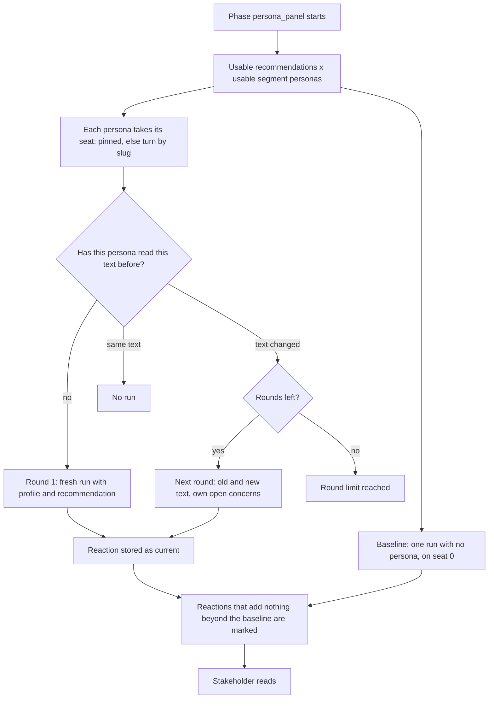

# Persona panel

In the `persona_panel` phase every usable recommendation is read by every usable segment persona,
each as its own run with a fresh context: the persona's profile, the recommendation, and nothing
else. No run plays two personas, and no persona sees another's reaction. The reactions are shown
side by side and are never merged into one. After the segment personas, the stakeholder reads run
(see [stakeholders.md](stakeholders.md#reads)).

Code: `src/core/market/panel.ts`, `panelRounds.ts`, `panelSettings.ts`, `panelView.ts`. Design:
[superpowers/specs/2026-11-16-persona-panel-design.md](superpowers/specs/2026-11-16-persona-panel-design.md).
How personas themselves are built: [personas.md](personas.md).

## What it is, and is not

A panel produces hypotheses: reasons a recommendation might land badly or well, to check with real
people. It is not a sample, not a measurement and not a verification step.

| A panel is for | A panel is never for |
|---|---|
| Finding objections before real people do | Replacing interviews or recruitment |
| Showing where audiences would disagree | Any number about real people: shares, sizes, "most customers" |
| Red-teaming a recommendation | Saying which segment prefers what, as a finding |
| A list of things to go and check | Validating an idea, or any final decision |

It differs from the [review council](council.md): a council verifies work, and its members' reviews
are merged into one verdict that can send the work back. A panel simulates reactions. They are never
merged, never pass or fail anything, and never block.

## How a panel run goes



## Configuration

With no `personaPanel` block the panel is what it was: every persona on `roles.persona`, every
recommendation read again on every run, and the feedback of before. Unlike the council, the block is
active as soon as it is there (seats, rounds and, unless turned off, a baseline run). So the example
file has none: without the block every persona runs on `roles.persona` and there is no baseline.

With the block:

```jsonc
"personaPanel": {
  "rounds": 3,                // most reads of one recommendation by one persona (default 3)
  "baseline": true,           // one run with no persona per recommendation (default true)
  "onUnavailable": "report",  // report | fail: what a persona that cannot run does (default report)
  "seats": [                  // personas take the seats in turn (default: one seat with roles.persona)
    { "provider": "claude", "model": "sonnet" },
    { "provider": "codex", "model": "gpt-6.1-sol", "effort": "medium" }
  ],
  "personas": { "smb-finance-lead": { "seat": 0 } }   // optional: pin a persona to a seat by its slug
}
```

### `seats`

The CLIs and models the personas run on. `provider` is one of BIF's CLIs (`cli` is accepted as
another spelling), `model` one of that provider's models, and `effort` is optional: it is passed
where the CLI has the setting and is a configuration error where it has none, as for a council
member.

The personas of a node, sorted by slug, take the seats in turn, so the assignment is the same on
every run and for every recommendation. A new persona moves the unpinned personas that sort after it
one seat on. Spread the panel over more than one model where you can: personas on one model share
its blind spots. A persona has the same seat when it judges flows, whatever `flows.model` says.

### `personas`

Pins a persona to a seat (`seat` is the place in `seats`, from 0). A pin moves nobody else. A pin to
a seat that does not exist is a configuration error. A pin for a slug no persona has is ignored,
because personas come and go.

### `rounds`

A persona reads a recommendation only when it has not read its text (title and summary) as it is
now. Reading unchanged work again is not a round, so a re-run of the phase starts no run for it.

When the text changed, the next round is a fresh run whose prompt shows the text that persona read
before and the text as it stands now. Each read is stored with its text; both are shown inside a
fence, as data. The prompt lists that persona's own earlier concerns that are still open, never
another persona's. The persona rules on each (`resolved`, or `stands` with a reason) and adds new
concerns only about what differs between the two texts. The new reaction becomes the current one and
the earlier rounds are kept.

After `rounds` reads nothing more runs for that persona and recommendation, and the page says "Round
limit reached". A reaction stored before the block was there counts as round 1. Its text was not
kept, so its next round is told so and shown the text as it stands now only.

### `baseline`

Each recommendation is also read by one run with no persona ("a general reader with no particular
stake"), on seat 0, with the same prompt and tool and by the same rule of rounds. It shows what the
personas add. A reaction whose concerns and reasoning say what the baseline says is marked "Adds
nothing beyond a general reader" and is not counted as agreement. It is left out of the ranges under
"Where they disagree" and out of the persona term of priority (which counts only when
`scoring.personaWeight` is above 0). The baseline is stored apart, is never a persona's feedback and
is not rated.

*Cost:* a baseline adds one run per recommendation per round. With 4 personas and 10 recommendations
a round is 50 runs instead of 40. A baseline that fails is reported, and the reactions to that text
then stay unmarked.

### `onUnavailable` and unavailable personas

A persona is unavailable for a recommendation when its seat cannot be started (the provider is
disabled, or the model is not in that provider's `models`) or its run ends without a valid answer
after the one retry. It is never run on another seat or model. A seat that cannot be started is not
a configuration error, so one configuration works on machines with different CLIs: the server
prints a warning at start-up that names the seat.

- With `"report"` (default) the panel goes on without that persona, and the page shows it as
  "Unavailable" with the reason.
- With `"fail"` every persona that can run still runs and its reactions are kept, and the panel phase
  then ends as failed with a reason that names the persona, its provider and model and the cause.

A baseline that cannot be had never fails the phase.

## The answer

With the block, the prompt states the rules of a persona: you are one person; ground each concern in
your profile or say you are unsure; do not please; judge the recommendation as given; nothing is
precious; no numbers about other people; argue the other side; work alone.

It asks for more than scores:

- the other side: what would make the persona dismiss it if it liked it, or take it up if it did not;
- another route to the same goal;
- what it is unsure about because its profile does not say;
- for each concern, the part of the profile it rests on.

A concern without a basis is kept and shown as "No basis in the profile". A sentence that makes a
claim about other people in numbers (a share of a group, "most customers", a market size) is found by
a simple pattern check and shown struck out with "About other people: not counted" and the reason.
The check runs over every text of an answer that the page shows, the basis of a concern and the
reason of a ruling included. Nothing a persona wrote is deleted. An earlier concern keeps these marks
when a later round lists it for a ruling: its basis, "No basis in the profile", or its struck-out
sentence.

## What you see

On the Strategy page, in the Simulated column of a recommendation, each persona shows:

- its round and its seat ("Runs on");
- its scores, to rate as before;
- its concerns with what each rests on, the other side, another route, what it is unsure about;
- its rulings on its earlier concerns ("Resolved", "Still stands"), each earlier concern with the
  marks it was raised with;
- its earlier rounds on demand.

Above the personas, "Where they disagree" (marked simulated, as every reaction is) lists each scale
on which the counted personas differ by two points or more, as the range ("adoption 1 to 4"). No
average of persona scores is shown anywhere: an average hides the disagreement, and an average of
simulated people is not a number about real ones. Below them, "General reader (no persona)" opens the
baseline.

All of it is served with the recommendation by `GET /api/workspaces/:id/recommendations` (`panel`),
and all of it stays marked simulated: it is a list of things to check with real people, and it
changes no score and no priority by itself. In the export the baseline is a `persona_feedback` line
marked `baseline: true` that joins no rating. Stakeholder reads are unchanged: they have their own
tool and the offline rule.

## The development skill and credit

For BIF's own development the same idea is a skill, `.claude/skills/persona-panel/SKILL.md`. Both are
adapted from the council skill of tstack
(https://github.com/t3dotgg/tstack/blob/main/skills/council/SKILL.md).
