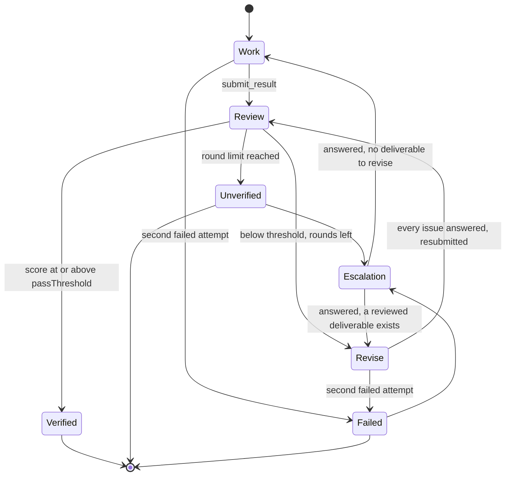

# Research pipeline and review loop

How a business is set up, how research runs phase by phase, and how every result is reviewed.
Code: `src/core/workspace/`, `src/core/interview/`, `src/core/research/` (`phases.ts`,
`orchestrator.ts`, `reviewLoop.ts`), `src/core/escalation/`, `src/core/policy/`,
`src/core/scheduler/`.

## Workspaces and the business map

A workspace is one business or one part of it. Its *scope* is `company`, `division` or `slice` (a
product line, region, team or internal platform), with *audiences* `external` (customers),
`internal` (employees) or both.

Workspaces form a tree. The optional `mapping` phase proposes child units, which you accept, edit or
reject. A node can read and cite anything in its own tree (tagged with the source), never another
tree. Parents roll up their children's symptoms and recommendations and flag patterns seen in two or
more children as possible company-wide issues.

## Interview

A resumable chat with an interviewer agent. It fills the profile (basics, revenue model, customers,
what is going well, what is going badly) and records symptoms with severity, trend and confidence.
Uploads (CSV, PDFs, decks) are optional evidence.

## Phases

A pipeline runs these phases in order. `mapping` is optional and always comes first when asked for.

```mermaid
flowchart LR
  I[Interview] --> M[mapping - optional]
  M --> MR[market_research]
  MR --> CD[competitor_discovery]
  CD --> DD[deep_dives]
  DD --> SH[stakeholders]
  SH --> FR[flow_ranking]
  FR --> SY[synthesis]
  SY --> PP[persona_panel]
  PP --> SC[scoring]
  SC --> R[Ranked recommendations]
```

| Phase | How it runs | Task types the orchestrator may propose |
|---|---|---|
| `mapping` | orchestrator | `map_business_units` |
| `market_research` | orchestrator | `audience_segments`, `persona_profile`, `customer_pain_points`, `news_scan` |
| `competitor_discovery` | orchestrator | `discover_competitors`, `news_scan` |
| `deep_dives` | orchestrator | `flow_walkthrough`, `flow_reviews`, `news_scan`, `public_filings`, `customer_pain_points`, `own_company_audit` |
| `stakeholders` | orchestrator, then the question round and the combine run | `own_stakeholders`, `competitor_stakeholders` |
| `flow_ranking` | runner (no orchestrator) | none |
| `synthesis` | orchestrator | `symptom_hypotheses`, `synthesize_recommendations` |
| `persona_panel` | runner (no orchestrator) | none |
| `scoring` | runner: recomputes every recommendation's priority with the current weights | none |

For a scope with internal audiences, `competitor_discovery` looks for alternatives (vendor tools,
outsourcing, peer practices) and `market_research` also covers internal roles.

An **orchestrator phase** starts a fresh orchestrator run that proposes tasks with `propose_tasks`.
The program validates them: the task type must be allowed in the phase, the model enabled, the task
not a duplicate (same type, subject and brief) and within `limits.maxTasksPerRun`. Then the workers
run. When the tasks are done the orchestrator gets one follow-up round with the results (failed
tasks included), so a phase has at most two orchestrator runs.

A task without a `model` uses the configured default for its type (`roles.workers.<type>`, else
`roles.workers.default`; recommendation synthesis uses `roles.synthesizer`). Explicit overrides are
recorded as such in the task-proposal decision.

A **runner phase** calls code directly: `flow_ranking` (see [flows.md](flows.md)), `persona_panel`
(see [persona-panel.md](persona-panel.md) and [stakeholders.md](stakeholders.md#reads)) and
`scoring`.

The pipeline stops after a phase that fails. Progress is saved after every phase, so a restart
continues the interrupted phase and the remaining ones.

## Review loop

Every worker result goes to a new reviewer run with minimal context. The reviewer scores it 0–10 and
lists issues, each `blocking`, `substantive`, `nit` or `scope_expansion`.

- Score ≥ `passThreshold` (default 8): the task is *verified*. Only a valid review from a reviewer
  run that finished can pass.
- Otherwise the worker fixes or pushes back on each issue (`respond_to_review`) and resubmits.
  Pushback on nits and scope expansion is expected and logged.
- After `maxRounds` (default 3) without a pass the task stays *unverified* and is flagged with that
  status.
- A worker step (first work or a revision) whose run fails, ends without `submit_result` or leaves an
  issue unanswered is retried once with a new run. A second failure marks the task *failed*.
- A reviewer run that fails or gives no valid review counts as score 0 with one blocking issue.

For a task type named in `council.stages`, each review step is a council round instead of one
reviewer run (see [council.md](council.md)).

### What a task's status does to its outputs

The task's findings, recommendations, personas, competitors and symptom hypotheses take its final
status (*verified*, *unverified* or *failed*). Outputs from an earlier round that the final submitted
revision neither re-saved nor cited by id are *superseded* and never used (for example a "$10"
finding corrected to "$20", or a claim dropped without replacement). The reviewer sees the content of
the submitted outputs and their evidence ids.

Only verified findings feed recommendation synthesis (from any node of the same business tree). On
the Findings & Evidence page you can include an unverified finding (or exclude a verified one) with
the "Use in recommendations" toggle. Likewise only verified recommendations and personas go to the
persona panel ("Use in persona panel" toggle on the Strategy and Audience & Personas pages). Strategy
flags unverified recommendations with the last reviewer's objections and hides failed ones unless you
include them ("Show failed" lists them). The Competitors page, the review queue and the interviewer's
drill-down use only verified (or included) competitors and hypotheses.

### Review history and disputes

Every review round's issues are kept (`review_issues`). Issue ids are stable across rounds when the
reviewer repeats an issue. Each issue has a fate: `open`, `fixed`, `pushed_back`, `upheld`
(reasserted after a pushback) or `withdrawn` (dropped after a pushback). The next reviewer sees the
issues the worker pushed back on, with the worker's reason, and must accept or reassert each. After
`loop.maxReasserts` reasserts the worker is told to fix it.

## Escalations

When a task ends *unverified* or *failed*, an `escalation` agent may ask you up to three
multiple-choice questions about it (one option recommended, preselected) in the "Waiting on you"
banner. Once every question of that escalation is answered (not all dismissed), the task runs again
through the review loop, with a fresh round budget, your answers and a summary of what its previous
attempt did and why it failed review. A task with a reviewed deliverable starts again as a revision
of it; otherwise the work is done again. At most `escalation.maxPerTask` escalations per task. Tasks of
type `own_stakeholders` are never escalated (see [stakeholders.md](stakeholders.md)). Settings:
[configuration.md](configuration.md#escalation).

## Action policy

Agents may browse, sign up with disposable identities and walk checkout up to payment. Payment
details, demo requests and contacting real people need your approval (the "Waiting on you" banner).
Purchases are never made. The lists live in `actionPolicy` and in every worker prompt.

## Policy history

Every approval request, grant and denial and every blocked attempt (a tool call outside the role's
scope, or an approval request for a *never* action) is recorded. Worker, synthesizer and
orchestrator prompts list that role's last five denials in the same business tree, so agents stop
retrying refused actions. API: `GET /api/workspaces/:id/policy-events`.

## Scheduler and "What changed"

Recurring jobs per workspace (cron) re-run phases. Each run is diffed against the previous run of the
same phase and schedule, shown on the Research page. The diff lists:

- the facts the run replaced (old → new), retracted and confirmed (from its applied fact changes);
- new findings (text matching only for facts saved as `new`);
- subjects no longer found;
- changed screenshots.

The same step records the decision outcomes once each through one path: the run's lineage outcomes,
`contradicted` (a previous fact the run neither confirmed, replaced nor retracted, when it saved a
new fact on the same subject with another claim), `changed` (a cited screenshot changed) and `stale`
(past its TTL). Replaying the step after a restart adds nothing.

The scheduler also runs the weekly retro and reviewer-audit schedules (see
[learning.md](learning.md)). Missed runs execute once on the next start.
